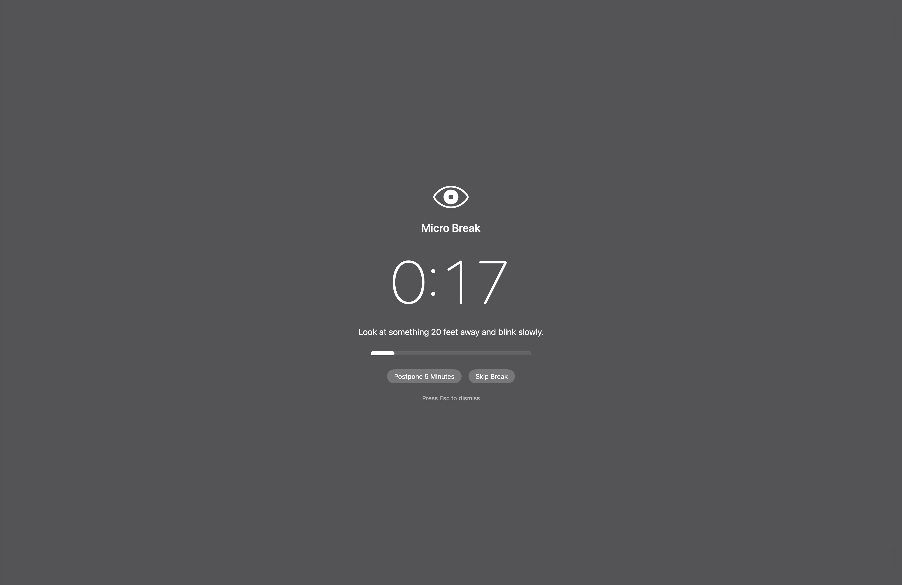
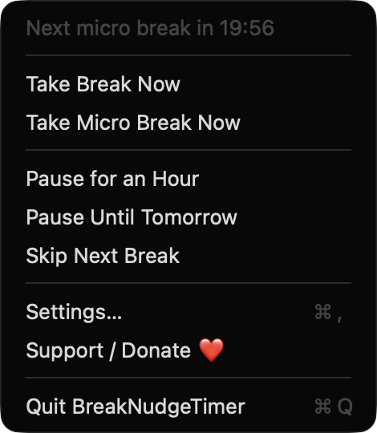
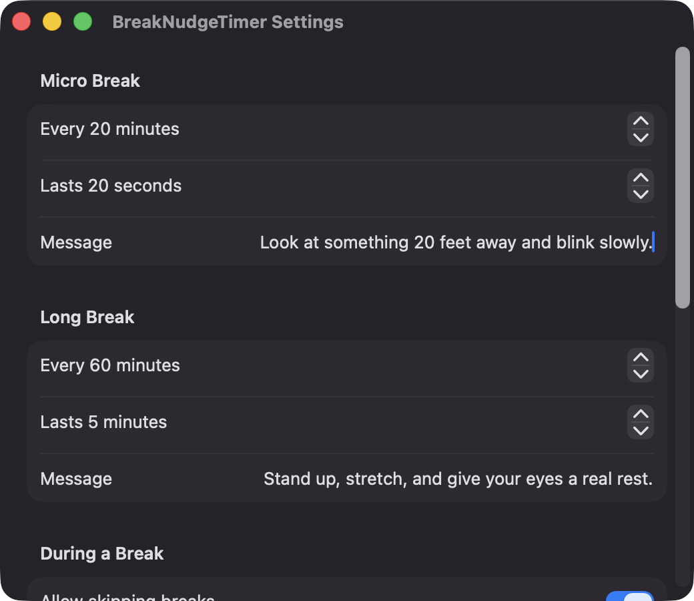

# BreakNudgeTimer

**🌐 Website:** [turhe123.github.io/break-nudge-timer](https://turhe123.github.io/break-nudge-timer/)

Gentle micro-breaks and long breaks that dim your screen, count down and remind you to rest your eyes.


## Why

BreakNudgeTimer is a free, open-source, 100% native, backend-free alternative to paid utilities in the *Timers & Reminders* category. It was inspired by the long-standing break reminder Time Out ($9.95 one-time), and aims to cover the essentials of regular micro and long breaks with a gentle overlay, with no accounts, servers or subscriptions.

## Features

- **Two repeating break types**: a Micro Break (default 20 seconds every 20 minutes) and a Long Break (default 5 minutes every 60 minutes). Interval, duration and message are configurable for each.
- **Menu bar countdown**: the menu bar item shows the time until the next break, or "Paused" / "Break" when relevant.
- **Menu actions**: Take Break Now, Take Micro Break Now, Pause for an Hour, Pause Until Tomorrow, Resume, Skip Next Break, Settings and Quit.
- **Full-screen overlay on every display**: a blurred, dimmed window with a large countdown, your message, and a progress bar, with a fade in and out.
- **Postpone or skip**: optional "Postpone 5 Minutes" and "Skip Break" buttons, each toggleable in Settings.
- **Escape always works**: Esc dismisses the overlay unless you enable strict mode, which removes Esc and the buttons but still ends when the timer runs out.
- **Activity-aware timing**: work time only counts while you are active (less than 60 seconds idle). Being idle for a configurable number of minutes (default 5) resets the timers as a natural break.
- **Sleep, wake and lock aware**: time away while the Mac sleeps or the screen is locked can count as a break if it is long enough.
- **Do not disturb**: optionally skips breaks while displays are mirrored or the frontmost app is full screen.
- **Pre-break notification**: a heads-up 30 seconds before a break. If notifications are denied, the app falls back to the overlay only.
- **If both are due, only the long break shows**, and it also resets the micro-break timer.
- **Sound** when a break ends (None, Glass, Ping, Hero, Purr, Submarine or Tink).
- **Launch at login** via `SMAppService`.
- **Immune to clock changes**: intervals use a monotonic clock.

## Screenshots

<p align="center"></p>

<p align="center"><em>A micro break dims the whole screen with a large countdown, your reminder message, a progress bar, and optional Postpone and Skip buttons.</em></p>

<p align="center"></p>

<p align="center"><em>The menu bar menu shows when the next break is due and lets you take a break now, pause, or skip the next one.</em></p>

<p align="center"></p>

<p align="center"><em>Settings let you choose the interval, duration and message for both micro and long breaks.</em></p>

## Install

1. Download `BreakNudgeTimer-macOS.zip` from the [latest release](https://github.com/turhe123/break-nudge-timer/releases/latest).
2. Unzip it and move `BreakNudgeTimer.app` to `/Applications`.
3. Because the app is open source and not notarized, clear the quarantine attribute:

   ```bash
   xattr -cr /Applications/BreakNudgeTimer.app
   ```

4. Right-click the app and choose **Open** the first time.

## Build from source

Requires macOS 14+ and Xcode with Swift 5.9+.

```bash
brew install xcodegen
xcodegen generate
xcodebuild -project BreakNudgeTimer.xcodeproj -scheme BreakNudgeTimer -configuration Release -derivedDataPath ./build build
```

The app is produced at `build/Build/Products/Release/BreakNudgeTimer.app`.

## Permissions

Based on the source, the app asks for very little:

- **Notifications** (requested at launch): used only for the 30-second pre-break heads-up. Optional; if denied, breaks still show as an overlay.
- **Login Items** (only if you turn on "Launch at login"): registered through `SMAppService`. macOS may show it in System Settings › General › Login Items.

The app does **not** request Accessibility, Screen Recording or Microphone access. Idle time is read with `CGEventSource` (with an IOKit fallback), and full-screen detection only inspects window owner and size via `CGWindowListCopyWindowInfo`; it does not capture screen contents or read window titles.

## Built with AI

BreakNudgeTimer was written by [Claude Code](https://claude.com/claude-code) inside an automated pipeline, from a plain-English spec. No code, binaries or assets from any commercial app were used; it is a clean-room reimplementation of a feature set, not a copy.

What that means in practice:

- The full source is in this repo under the MIT license. Read it before you run it.
- No network calls, no analytics, no third-party dependencies. Only Apple frameworks.
- Ad-hoc signed and not notarized, which is why Gatekeeper warns on first launch.
- It has had less human review than a hand-written app. Bug reports and pull requests are welcome.

## Support ❤️

If BreakNudgeTimer helps you, you can support its development:

[Support Or (Leo) Davidai ❤️ on Ko-fi](https://ko-fi.com/leodavidai)

## License

MIT © Or Davidai Bachar
